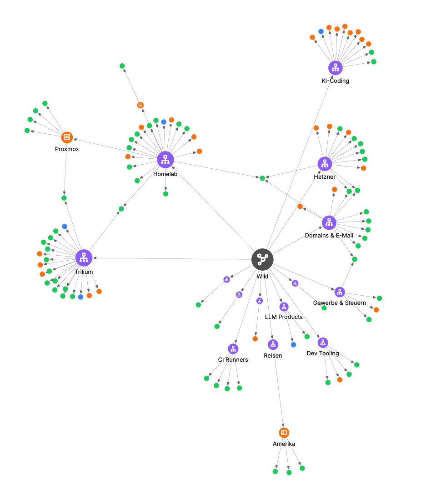

<h1 align="center"><a href="https://github.com/Marceltov/trilium-llm-wiki">trilium-llm-wiki</a></h1>

<p align="center">
  <a href="https://trilium-mcp-proxy.marceltov.de/">
    
  </a>
  <a href="https://trilium-llm-wiki.marceltov.de/">
    
  </a>
  <a href="LICENSE">
    
  </a>
</p>

A [Claude Code](https://code.claude.com) plugin that builds and maintains an LLM wiki in [Trilium Notes](https://triliumnotes.org), after [Karpathy's LLM-wiki pattern](https://gist.github.com/karpathy/442a6bf555914893e9891c11519de94f): you collect sources, Claude writes interlinked summary, concept, entity and hub pages, answers questions from them and lints them. The rules live in a schema note in your Trilium Notes instance.

<p align="center"><br><em>A real wiki after a few weeks, as Trilium's note map</em></p>

> [!IMPORTANT]
> This plugin uses the MCP server built into Trilium Notes 0.106+ (*Options → AI / LLM → MCP server*). Connect to it with an ETAPI token, or put [trilium-mcp-proxy](https://trilium-mcp-proxy.marceltov.de/) in front of it to sign in with your Trilium Notes password instead (the password never leaves your server). The plugin sets up the connection, but runs neither.

**Full documentation: [trilium-llm-wiki.marceltov.de](https://trilium-llm-wiki.marceltov.de/)**

Optional: the [recall engine](https://trilium-llm-wiki.marceltov.de/recall/) (`recall-engine/`, image `ghcr.io/marceltov/trilium-llm-wiki-recall`) lets Claude find what the wiki knows on its own, through a prompt hook and an MCP `recall` tool.

## Install

```
/plugin marketplace add Marceltov/trilium-llm-wiki
/plugin install trilium-llm-wiki
```

Then start a new session: Claude offers to connect your Trilium Notes instance if none is configured. Ask it to "set up the LLM wiki" to create the structure.

Want Claude to work with your existing notes rather than build a wiki? That's the [Trilium Notes plugin](https://github.com/Marceltov/trilium-plugin). Both can be installed together and share one connection.

## What's inside

| Path | What it is |
|---|---|
| `skills/trilium-llm-wiki/` | the wiki skill, `schema.html` (the default rulebook) and `setup.py` (creates the structure) |
| `skills/trilium-manage-instances/` | connects Trilium Notes instances with `claude mcp add` |
| `hooks/`, `scripts/check-trilium-credentials.sh` | offers the connection setup once if no instance is configured |
| `shared/rules.md` | rules every skill gets a copy of; `scripts/sync-shared.sh` copies it |
| `tests/test_setup.py` | runs `setup.py` twice against a fake ETAPI |

## Develop

```
scripts/sync-shared.sh            # after editing shared/rules.md
bash scripts/test-check-trilium-credentials.sh
python3 -I tests/test_setup.py
```

`trilium-manage-instances`, `shared/rules.md` and the credential check are copies of the ones in [trilium-plugin](https://github.com/Marceltov/trilium-plugin). Keep them in step when one changes.

## License

[MIT](LICENSE)
